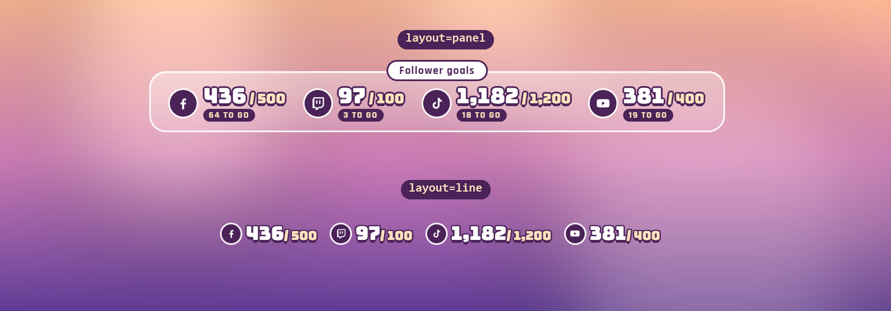
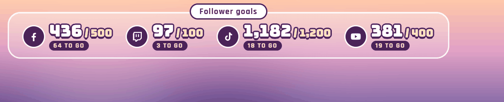
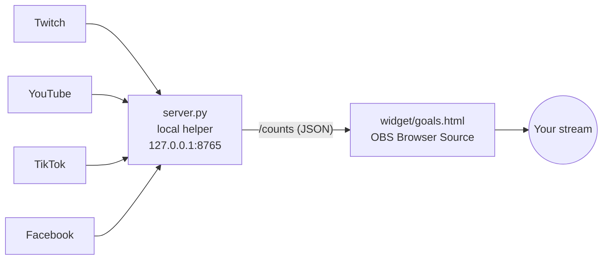

<div align="center">

# 🎯 OBS Follower Goals

**Live follower counts for Twitch, YouTube, TikTok and Facebook, shown as follower goals right inside OBS.**

Every platform automatically aims for its next hundred (127 → **200**, 200 → **300**), counts up when someone follows,
and celebrates when you hit a goal.

[](LICENSE)






</div>

---

## ✨ Features

- **Four platforms, one widget**: Twitch, YouTube, TikTok and Facebook side by side.
- **Automatic goals**: each count aims for the next multiple of 100 (or any step you like), with an "N to go" label.
- **Feels alive**: numbers count up smoothly, a **+N** pops on every new follower, and the goal flashes when you reach it.
- **Two looks**: a glass **panel** with a "Follower goals" tab, or a compact **line** with no background for gameplay.
- **Fully customisable from the URL**: platforms, order, goal step, colours, font, size, title.
- **No accounts to link for Twitch, TikTok or Facebook**. YouTube only needs a free API key.
- **Tiny and private**: one Python file with zero dependencies, running on your own PC. Nothing is sent anywhere except the platform lookups.
- **Starts with Windows** (optional), silently in the background.

## 🧭 How it works



1. **`server.py`** runs on your PC. Every minute or so it looks up your follower counts and keeps the latest values.
2. **`widget/goals.html`** is added to OBS as a Browser Source. It asks the helper for the numbers every 15 seconds and draws the goals.

| Platform | Where the number comes from | What you need |
|---|---|---|
| **Twitch** | [DecAPI](https://decapi.me) public follow count (or your own Twitch app, optional) | Your channel login |
| **YouTube** | Official YouTube Data API v3 (subscribers) | A free API key + your @handle |
| **TikTok** | Your public profile page, read with a headless browser | Your username + Chrome or Edge installed |
| **Facebook** | Your public page (or the Graph API, optional) | Your page name + Chrome or Edge installed |

---

## 🚀 Quick start

### 1. Requirements

- **Windows, macOS or Linux**
- **[Python 3.8 or newer](https://www.python.org/downloads/)** (on Windows tick *"Add python.exe to PATH"* in the installer)
- **[OBS Studio](https://obsproject.com/)** 27 or newer
- **Google Chrome, Microsoft Edge or Chromium**, only if you want TikTok or Facebook (Windows already has Edge)

### 2. Download

```bash
git clone https://github.com/ruchira-edirisinghe/obs-follower-goals.git
cd obs-follower-goals
```

Or click **Code → Download ZIP** above and unzip it somewhere permanent (for example `Documents\obs-follower-goals`).

### 3. Add your channels

Copy `.env.example` to your home folder as **`.env.followers`** and fill in the platforms you use:

| OS | Settings file |
|---|---|
| Windows | `C:\Users\<you>\.env.followers` |
| macOS / Linux | `~/.env.followers` |

```ini
TWITCH_LOGIN=yourchannel
YOUTUBE_API_KEY=AIza...your-key...
YOUTUBE_HANDLE=@yourchannel
TIKTOK_USERNAME=yourname
FACEBOOK_PAGE_ID=yourpage
```

Leave a platform empty and it simply won't appear. See [Platform setup](#-platform-setup) for where each value comes from.

> 🔒 This file can hold an API key. Keep it private and never commit it (it's already in `.gitignore`).

### 4. Test it

```bash
python server.py --once
```

You should see your counts:

```json
{
  "twitch":  { "count": 97,   "ok": true, "err": null, "at": 1763460000 },
  "youtube": { "count": 381,  "ok": true, "err": null, "at": 1763460001 },
  "tiktok":  { "count": 1182, "ok": true, "err": null, "at": 1763460009 },
  "facebook":{ "count": 436,  "ok": true, "err": null, "at": 1763460014 }
}
```

### 5. Run the helper

```bash
python server.py
```

Leave it running while you stream. Check it any time at <http://127.0.0.1:8765/counts>.

**Windows: start it automatically at sign-in (recommended):**

```powershell
powershell -ExecutionPolicy Bypass -File scripts\install-autostart.ps1
```

This adds a shortcut to your Startup folder that runs the helper silently (no window) and starts it right away.
To undo it: `scripts\uninstall-autostart.ps1`.

### 6. Add the widget to OBS

1. In OBS, click **+** under **Sources** → **Browser**.
2. Tick **Local file** and pick `widget/goals.html`.
3. Set **Width 1200**, **Height 200** (line layout: 1000 × 100).
4. Click **OK**, then drag and resize it where you want it.

Want options? Untick **Local file** and paste a URL instead, for example:

```text
file:///C:/Users/you/Documents/obs-follower-goals/widget/goals.html?layout=line&platforms=twitch,youtube
```

Not streaming yet? Add `?demo=1` to preview it with fake numbers that tick up.

---

## 🎨 Widget options

Add any of these to the widget URL, joined with `&` (e.g. `goals.html?layout=line&step=50&scale=1.2`).

| Option | Default | What it does |
|---|---|---|
| `layout` | `panel` | `panel` = glass card with a tab · `line` = compact, no background |
| `platforms` | `facebook,twitch,tiktok,youtube` | Which platforms to show, in this order |
| `step` | `100` | Goal size: the goal is the next multiple of this (`step=50`: 127 → 150) |
| `title` | `Follower goals` | Text on the panel tab (empty = no tab) |
| `togo` | `1` | `0` hides the "N to go" labels |
| `glass` | `1` | `0` removes the panel background but keeps the layout |
| `scale` | `1` | Size multiplier, e.g. `1.5` |
| `ink` | `4b2358` | Outline and icon colour (hex, no `#`) |
| `accent` | `ffe2bf` | Goal number and label colour |
| `text` | `ffffff` | Count colour |
| `font` | `Bungee` | Any [Google Font](https://fonts.google.com) for the numbers, e.g. `font=Titan+One`, or a font installed on your PC |
| `poll` | `15` | Seconds between updates from the helper |
| `server` | `http://127.0.0.1:8765` | Helper address (change it if you moved the port or run it on another PC) |
| `showEmpty` | `0` | `1` shows platforms that have no count yet (as 0) |
| `demo` | `0` | `1` shows fake, animated numbers: no helper needed |

**Recipes**

```text
goals.html?layout=line&scale=0.8                       small and subtle for gameplay
goals.html?platforms=twitch,youtube&step=50            just two platforms, goals every 50
goals.html?ink=0b1f3a&accent=7ee0ff&title=Road+to+1K   your own colours and tab text
```

---

## 🔧 Platform setup

<details>
<summary><b>Twitch</b>: no key needed</summary>

Set `TWITCH_LOGIN` to your channel name (the part after `twitch.tv/`).
The count comes from the free [DecAPI](https://decapi.me) service.

**Optional: use the official Twitch API instead.** Register an app at <https://dev.twitch.tv/console/apps>
(Twitch requires two-factor authentication for this), set the redirect URL to `https://localhost`, choose
*Public* client type, and put its Client ID in `TWITCH_CLIENT_ID`. Then sign in once:

```bash
python server.py --twitch-login
```

Open the link it prints, approve, and you're done. The login is saved to `~/.twitch-token.json` and refreshed automatically.
</details>

<details>
<summary><b>YouTube</b>: free API key</summary>

1. Open the [Google Cloud Console](https://console.cloud.google.com/) and create a project (any name).
2. Go to **APIs & Services → Library**, search **YouTube Data API v3** and click **Enable**.
3. Go to **APIs & Services → Credentials → Create credentials → API key**.
4. Recommended: click the key, choose **Restrict key**, and allow only *YouTube Data API v3*.
5. Put it in `YOUTUBE_API_KEY`, and your `@handle` in `YOUTUBE_HANDLE` (or your `UC…` channel ID in `YOUTUBE_CHANNEL_ID`).

The free quota (10,000 units a day) is far more than the helper uses (about 1,440 a day).
YouTube rounds public subscriber counts above 1,000 (e.g. 12,345 → 12,300).
</details>

<details>
<summary><b>TikTok</b>: username only</summary>

Set `TIKTOK_USERNAME` (without the `@`). TikTok blocks simple web requests, so the helper opens your public
profile in a hidden Chrome/Edge window and reads the follower number. It checks every 5 minutes by default
(`TIKTOK_EVERY` to change). This is an unofficial method: if TikTok changes its page, the count may stop updating
until the helper is updated.
</details>

<details>
<summary><b>Facebook</b>: page name only</summary>

Set `FACEBOOK_PAGE_ID` to your page's username or numeric ID (the part after `facebook.com/`).
The helper reads the "N followers" shown on your public page every 5 minutes.

> Tip: use your page's normal address. Some special URLs (such as `facebook.com/gaming/...`) hide the follower count.

**Optional: Graph API.** If you have a page access token, put it in `FACEBOOK_PAGE_TOKEN` for an exact,
faster count straight from Facebook.
</details>

---

## 🖥️ Helper reference

```text
python server.py                      run the helper (Ctrl+C to stop)
python server.py --once               fetch everything once, print it and exit
python server.py --twitch-login       one-time sign-in for your own Twitch app
python server.py --port 9000          use another port (then add &server=http://127.0.0.1:9000 to the widget)
python server.py --env D:\my.env      use another settings file
python server.py --host 0.0.0.0       listen on your network (to run the helper on another PC)
python server.py --version
```

| Endpoint | Returns |
|---|---|
| `GET /counts` | `{ "<platform>": { "count", "ok", "err", "at" } }`. `count` is the last good value, `err` explains any problem |
| `GET /health` | `{ "ok": true, "version": "1.0.0" }` |

Environment variables `FOLLOWER_GOALS_ENV` and `FOLLOWER_GOALS_PORT` can replace `--env` and `--port`.
The settings file is re-read every cycle, so edits apply without a restart.

---

## 🩺 Troubleshooting

| Problem | Fix |
|---|---|
| Widget shows *"helper not running"* | Start `server.py` (or run the autostart installer) and check <http://127.0.0.1:8765/counts>. |
| A platform is missing | Its settings line is empty, or the lookup failed. Look at its `err` in `/counts` or run `python server.py --once`. |
| TikTok / Facebook show `no Chrome/Edge/Chromium found` | Install Chrome or Edge, or set `BROWSER_PATH` to the browser's .exe. |
| Facebook count is wrong or missing | Use your page's normal URL name in `FACEBOOK_PAGE_ID`, not a `/gaming/` link. |
| YouTube shows `HTTPError 403` | The API isn't enabled for your key's project, or the key is restricted to a different API. |
| Numbers don't change in OBS | Right-click the source → **Refresh**. Counts for TikTok/Facebook update every 5 minutes by default. |
| Fonts look plain | The widget loads Google Fonts; make sure the PC is online, or set `font=` to a font installed locally. |
| Port 8765 is already used | Run with `--port 9000` and add `&server=http://127.0.0.1:9000` to the widget URL. |

## ❓ FAQ

**Does it work with Streamlabs Desktop or other software?** Yes. Anything that can show a web page (browser source) works.

**Does it need my passwords?** No. Twitch, TikTok and Facebook use public information; YouTube uses an API key you create.

**Is it safe to stream with?** The widget only shows numbers. Your settings file is never shown on screen or sent anywhere.

**Can I show just one number?** Yes: `platforms=youtube`.

---

## 🤝 Contributing

Issues and pull requests are welcome, especially new platforms (Kick, Instagram, X) and new widget layouts.
Keep `server.py` dependency-free so it stays a one-file install.

## 📄 License

[MIT](LICENSE): free to use, change and share, including in commercial streams. Credit is appreciated but not required.

Twitch, YouTube, TikTok and Facebook are trademarks of their owners. This project is not affiliated with or endorsed by them.
Icons are simplified shapes for identification only.
